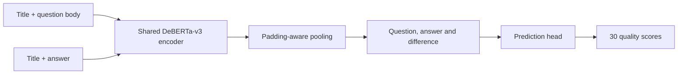

# Google QUEST Q&A Labeling

Predict **30 dimensions of question and answer quality** from a title, question body and answer. This project combines a modern transformer pipeline with question-group validation, a fast cross-validation baseline, and portable experiment artifacts for local analysis, Kaggle inference and MLflow tracking.

The official dataset contains **6,079 labeled pairs** and **476 downloadable test pairs**. Labels describe clarity, relevance, helpfulness and intent as fractional scores. Multiple answers can share one question, making the validation boundary especially important.

## Cross-validation without repeated-question leakage

The current protocol stratifies category domains while keeping every question body wholly within one fold. Five folds and seed 42 are declared before modeling. An analyzer checks category balance, all 30 target distributions, missing values, rare-label support and fold coverage.

| Split diagnostic | Grouped folds | Category-stratified groups |
|---|---:|---:|
| Maximum category distribution distance | 0.03880 | **0.00120** |
| Maximum target-histogram distance | 0.04382 | **0.03610** |
| Validation rows per fold | 1,215–1,216 | 1,215–1,217 |

Distances are total variation over the declared distributions; lower is more balanced. Every stratified fold contains variation in **all 30 targets**, including the rare `question_type_spelling` label.

A train-only **TF-IDF + Ridge** baseline provides an empirical stability check:

| Five-fold result | Observed value |
|---|---:|
| Pooled out-of-fold Spearman | **0.3261** |
| Fold mean / descriptive SD | **0.3267 / 0.0032** |
| Held-out prediction coverage | All 6,079 rows, exactly once |
| CPU runtime | About 28 seconds in the recorded environment |

Each fold fits its own vocabulary and IDF on training text only. These are text-baseline CV results, not five-fold transformer performance. Repeating the fixed recipe reproduced identical assignment and OOF prediction files. Saved assignments and input hashes provide the cross-runtime contract; the seed alone does not. The [aggregate CV receipt](docs/cv-validation.json) retains all target diagnostics and fingerprints.

## Shared transformer representations

A shared DeBERTa-v3 encoder reads title/body and title/answer pairs. Padding-aware mean pooling produces one vector for each. A prediction head combines both vectors and their difference, then predicts 30 independent sigmoid scores.



Training uses binary cross-entropy with fractional labels, AdamW, warmup, cosine decay, gradient accumulation and CUDA mixed precision. The pretrained revision, resolved configuration, split identities and checkpoint checksums are retained with the run.

The recorded full transformer experiment uses the earlier single question-group holdout: **4,863 training rows and 1,216 validation rows**. Its exact recipe is frozen in `configs/benchmark.json`. The current default in `configs/deberta.json` uses the newly analyzed stratified protocol; evaluating a saved model always uses that checkpoint's actual indices.

| Experiment | Evaluation | Score |
|---|---|---|
| Historical account submission, 10 February 2020 | Public / private leaderboard | 0.43155 / 0.40232 |
| Modern DeBERTa benchmark | One saved question-group holdout, 30 defined targets | **0.3779** |

Historical values come from Kaggle submission history. They are separate from either local CV result and do not prove the original source revision produced that submission. [Measured results](docs/results.md) report evaluation scope, target coverage and runtime evidence.

## Data-science walkthrough

The [executed notebook](notebooks/01-question-quality.ipynb) covers annotation distributions, repeated questions, split diagnostics, five-fold baseline results, model design and saved transformer artifacts. It also recomputes Spearman from ranked labels and saved predictions.

[Architecture notes](docs/architecture.md) explain the modeling decisions, metric edge cases and changes from the original TensorFlow implementation. Code and notebooks share the same data and split functions.

## Run the CPU analysis

The tested local environment is Linux/Python 3.12; the inspected Kaggle CUDA image uses Python 3.13. Source supports both Python versions.

```bash
uv sync --locked --group dev --group lab --group data
export QUEST_DATA_DIR=/absolute/path/outside/git/google-quest
.venv/bin/kaggle auth login
.venv/bin/quest download --data-dir "$QUEST_DATA_DIR"
.venv/bin/quest validate --data-dir "$QUEST_DATA_DIR"
.venv/bin/quest cv --data-dir "$QUEST_DATA_DIR" --config configs/cv.json \
  --run-dir .local/cv-run
```

Download requires Kaggle authentication and accepted competition rules. Use a fresh run directory for each experiment. Full transformer training uses a GPU; the [runbook](docs/reproduction.md) covers its CLI recipe, frozen fold plans and independent checkpoint evaluation.

For Docker JupyterLab:

```bash
.venv/bin/quest lab-token
docker compose -f docker/compose.yaml up --build -d lab
```

Open http://127.0.0.1:8892/lab using `.local/jupyter_token`. The CPU image supports exploration, CV and checkpoint inference, and also backs the dev container.

## Kaggle execution and shared MLOps

[The training notebook](notebooks/kaggle/train.ipynb) installs a verified code wheel and trains against the competition input. [Offline inference](notebooks/kaggle/inference.ipynb) reuses the completed training notebook's model/tokenizer outputs, verifies their hashes and writes `submission.csv`. QUEST scoring requires a notebook version; a local CSV alone does not establish a leaderboard result.

The completed model run was imported into the canonical `kaggle/quest` MLflow experiment, retaining its logical run ID and source fingerprint. A repeat import reused the same run, and a 709 MiB checkpoint round trip through the artifact proxy matched its byte hash. Shared MLflow, Prefect and SeaweedFS deployment is managed in [mlops-platform](https://github.com/cttsai1985/mlops-platform), independently of local or offline Kaggle execution. The runbook describes optional client-network and filesystem mounts. The [validation receipt](docs/validation.json) records completed checks and their limits.

## Development

```text
src/quest/        Data, split policies, CV analyzer, model, runtime and clients
configs/          Current recipes and the frozen benchmark configuration
notebooks/        Data-science walkthrough and thin Kaggle entry points
docs/             Architecture, runbook and measured results
docker/           JupyterLab image and optional shared-service connections
tests/            Data, split, metric, checkpoint and tracking contracts
legacy/           Original TensorFlow source and notebooks
```

```bash
.venv/bin/ruff check src tests
.venv/bin/ruff format --check src tests
.venv/bin/pytest -q
```

The original implementation is preserved in [legacy/](legacy/README.md) at `ef4fb92`. Code uses the [Apache 2.0 license](LICENSE); pretrained model and competition data retain their own terms. Raw text, trained weights, credentials, fold IDs and prediction rows stay outside Git.
