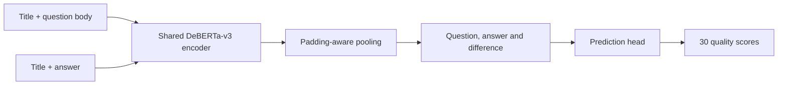

# Google QUEST Q&A Labeling

Predict **30 dimensions of question and answer quality** from a question title, question body and answer. The pipeline fine-tunes a shared DeBERTa-v3 encoder, keeps repeated questions together during validation, and exports a self-contained checkpoint for offline Kaggle inference.

The competition dataset contains **6,079 labeled question–answer pairs** and **476 downloadable test pairs**. Its targets include clarity, relevance, helpfulness and whether a question seeks facts or opinions. Labels are fractional annotation scores rather than mutually exclusive classes.

## Question and answer representations

The encoder reads two paired sequences: title + question body, and title + answer. Padding-aware mean pooling produces one representation for each. A small prediction head combines both representations and their difference, then predicts all 30 targets with sigmoid outputs.



Training uses binary cross-entropy with fractional labels, AdamW, cosine learning-rate decay with warmup, gradient accumulation and GPU mixed precision. Model selection uses mean column-wise Spearman correlation, matching the competition's ranking objective. The pretrained model revision and resolved training configuration are recorded with each run.

The [walkthrough](notebooks/01-question-quality.ipynb) examines label distributions, repeated questions, the validation split, model design and recorded experiment results. [Architecture and migration notes](docs/architecture.md) explain the differences from the original TensorFlow pipeline.

## Validation and results

Several rows can share the same question and have different answers. Splitting rows independently can therefore expose a validation question during training. The pipeline retains the original five-way question-group split and uses its first fold: **4,863 training rows and 1,216 validation rows**.

| Experiment | Evaluation | Score |
|---|---|---|
| Historical account submission, 10 February 2020 | Public leaderboard | **0.43155** |
| Same historical submission | Private leaderboard | **0.40232** |
| Modern DeBERTa run | Question-group holdout | Full-data GPU experiment in progress |

Historical values were retrieved from Kaggle submission history. They are performance targets, not measurements of the modern implementation. Holdout and leaderboard scores cover different populations and are reported separately. See [experiment results](docs/results.md).

## Reproduce an experiment

Python 3.12 or 3.13 is supported; the local lock is tested with Python 3.12. Full transformer training requires a suitable GPU for practical runtime.

```bash
uv sync --locked --group dev --group lab --group data
export QUEST_DATA_DIR=/absolute/path/outside/git/google-quest
.venv/bin/kaggle auth login
.venv/bin/quest download --data-dir "$QUEST_DATA_DIR"
.venv/bin/quest validate --data-dir "$QUEST_DATA_DIR"
.venv/bin/quest train --data-dir "$QUEST_DATA_DIR" \
  --config configs/deberta.json --run-dir .local/my-run
```

Kaggle authentication and accepted competition rules are required for download. Each training invocation requires a fresh run directory. Training saves the tokenizer, best checkpoint, validation predictions, test predictions, configuration, split identities and checksums.

For Docker JupyterLab:

```bash
.venv/bin/quest lab-token
docker compose -f docker/compose.yaml up --build -d lab
```

Open http://127.0.0.1:8892/lab using the token in the ignored `.local/jupyter_token`. The CPU container supports exploration and checkpoint inference; full benchmark training uses the private Kaggle GPU notebook. The same image backs the dev container. See the [runbook](docs/reproduction.md) for resource settings, Kaggle packaging and shared-service connections.

## Kaggle training and offline inference

[The training notebook](notebooks/kaggle/train.ipynb) installs the project wheel from an attached code dataset and trains on the official competition input. The [inference notebook](notebooks/kaggle/inference.ipynb) loads the completed model and tokenizer with internet disabled, verifies their checksums, and writes `submission.csv`.

QUEST is a notebook-only competition: scoring uses a notebook version and its output file. A local prediction CSV alone does not establish a leaderboard result.

## Development

```text
src/quest/        Data checks, model, training, evaluation and CLI
configs/          Declared experiment recipes
notebooks/        Data-science walkthrough and Kaggle entry points
docs/             Architecture, runbook and measured results
docker/           JupyterLab image and Compose configuration
tests/            Data, metric, grouping and checkpoint contracts
legacy/           Original TensorFlow source and notebooks
```

```bash
.venv/bin/ruff check src tests
.venv/bin/ruff format --check src tests
.venv/bin/pytest -q
```

The original implementation is preserved under [legacy/](legacy/README.md) at source revision `ef4fb92`. Code is licensed under [Apache 2.0](LICENSE); pretrained model and competition data have their own terms. Raw text, trained weights, credentials and prediction rows stay outside Git.
