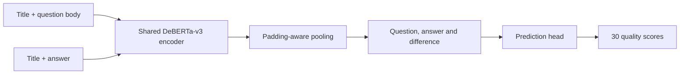

# Google QUEST: Question and Answer Quality

A useful answer needs to address the question, communicate clearly and fit the asker's needs. [Google QUEST](https://www.kaggle.com/c/google-quest-challenge) studies these judgments across **30 question-and-answer quality labels**. This solution combines a shared DeBERTa encoder with grouped evaluation and a lightweight text baseline to test what information improves the predictions.

The controlled TF-IDF/Ridge study raises mean OOF Spearman from **0.2201** with titles to **0.2943** with question bodies and **0.3256** with answers. The last gain comes from answer targets; question-target performance slightly declines. An answer-review workflow can use that extra information, while unanswered-question routing needs a question-only contract.

[Why the problem matters](docs/problem-and-value.md) · [Controlled experiments](docs/modeling-study.md) · [Run the model](#run-the-cpu-analysis)

<!-- portfolio-results:start -->
## Results

**Public leaderboard — mean Spearman ↑.**

| Model / submission | Public score | Public reference rank / teams | Top % | Reference ties |
|---|---:|---:|---:|---:|
| Historical account submission, 2020-02-10 15:32 UTC | 0.43155 | 82 / 1,572 | **5.22%** | 1 |
| Historical final submission, 2020-02-10 | 0.42654 | 104 / 1,572 | **6.62%** | 0 |
| Modern DeBERTa late notebook submission | 0.35189 | 1,193 / 1,572 | **75.89%** | 0 |

Reference: **2026-11-09T00:02:27Z**, **1,572 unique scored teams**. Ranks are score-equivalent comparisons with the dated public export, not awarded final ranks. Lower Top % is better. A zero tie count denotes an insertion position; ties occupy the shown interval.

**OOF/holdout rank and Top %: not applicable. Private leaderboard rank and Top %: unavailable without a matching private reference population.** Internal validation and private scores remain separately reported in [detailed results](docs/results.md). [Reference data and calculation](docs/leaderboard-context.json).
<!-- portfolio-results:end -->

## Learning from difficult answers

On the saved 1,216-row holdout, the 122 examples with the largest mean target-rank disagreement have higher answer-family disagreement (0.359 versus 0.231 on the remaining examples). Answer relevance and plausibility offer better-supported next investigations than spelling, whose label is almost constant in this holdout. Difficult answers are shorter on median, so a larger context budget is not yet justified. [Hard-case analysis, label support and next experiments](docs/error-analysis.md).

## Shared transformer representations

A shared DeBERTa-v3 encoder reads title/body and title/answer pairs. Padding-aware mean pooling produces one vector for each. A prediction head combines both vectors and their difference, then predicts 30 independent sigmoid scores.



Training uses binary cross-entropy with fractional labels, AdamW, warmup, cosine decay, gradient accumulation and CUDA mixed precision. The pretrained revision, resolved configuration, split identities and checkpoint checksums are retained with the run.

The recorded full transformer experiment uses the earlier single question-group holdout: **4,863 training rows and 1,216 validation rows**. Its exact recipe is frozen in `configs/benchmark.json`. The current default in `configs/deberta.json` uses the newly analyzed stratified protocol; evaluating a saved model always uses that checkpoint's actual indices.

| Experiment | Evaluation | Score |
|---|---|---|
| Historical account submission, 10 February 2020 | Public / private leaderboard | 0.43155 / 0.40232 |
| Modern DeBERTa benchmark | One saved question-group holdout, 30 defined targets | **0.3779** |
| Same modern model, late notebook submission | Public / private leaderboard | **0.35189 / 0.32983** |

Historical values come from Kaggle submission history. They are separate from either local CV result and do not prove the original source revision produced that submission. [Measured results](docs/results.md) report evaluation scope, target coverage and runtime evidence.

The historical public score **0.43155** corresponds to approximately **top 5.2%** of the downloaded public leaderboard; the modern DeBERTa rerun's **0.35189** corresponds to **top 75.9%**. The performance gap remains explicit. [Percentile method and snapshot](docs/results.md#leaderboard-percentile-context). These are score-equivalent positions, separate from official late-entry ranks.

## What answer text adds

The lightweight input ablation improves the overall 30-target score when answer text is added. Breaking it down shows a tradeoff: the **nine answer-target mean improves**, while the **21 question-target mean slightly worsens** across all three split plans. Those are family averages, not a claim about every individual label.

For the current equally weighted objective, retaining answer text is supported. A question-only consumer would need a different acceptance criterion. Model selection therefore follows the intended use: question routing and answer review need different acceptance metrics. A target-specific representation is an untested follow-up, not a claimed improvement. [Evidence and interpretation](docs/modeling-study.md) · [Executed notebook](notebooks/02-controlled-ablations.ipynb).

This solution consumes shared tracking and storage. Its actual model was independently evaluated and its checkpoint bytes verified after transfer; interrupted-import recovery is also tested with controlled fixtures. The shared batch-operation drill uses Iceberg, without implying a scheduled QUEST production service. [Consumer contract](docs/consumer-contract.md) · [Original walkthrough](notebooks/01-question-quality.ipynb).

The official dataset contains **6,079 labeled pairs** and **476 downloadable test pairs**, with 30 fractional question/answer quality labels. Multiple answers can share a question.

## Use the saved model

The [model packaging and serving guide](docs/serving.md) explains the actual input/output contract, export from saved artifacts and the shared HTTP parity check. A canary release retains the tested source, dependency lock and aggregate verification evidence; private model weights and request rows are not release assets.

[Real-model canary verification](docs/canary-validation.json) records the source, package/runtime identity, native-to-HTTP parity and rejected invalid request.

## Cross-validation without repeated-question leakage

The current protocol stratifies category domains while keeping every question body wholly within one fold. Five folds and seed 42 are declared before modeling. An analyzer checks category balance, all 30 target distributions, missing values, rare-label support and fold coverage.

| Split diagnostic | Grouped folds | Category-stratified groups |
|---|---:|---:|
| Maximum category distribution distance | 0.03880 | **0.00120** |
| Maximum target-histogram distance | 0.04382 | **0.03610** |
| Validation rows per fold | 1,215–1,216 | 1,215–1,217 |

Distances are total variation over the declared distributions; lower is more balanced. Every stratified fold contains variation in **all 30 targets**, including the rare `question_type_spelling` label.

A train-only **TF-IDF + Ridge** baseline provides an empirical stability check:

| Five-fold result | Observed value |
|---|---:|
| Pooled out-of-fold Spearman | **0.3261** |
| Fold mean / descriptive SD | **0.3267 / 0.0032** |
| Held-out prediction coverage | All 6,079 rows, exactly once |
| CPU runtime | About 28 seconds in the recorded environment |

Each fold fits its own vocabulary and IDF on training text only. These are text-baseline CV results, not five-fold transformer performance. Repeating the fixed recipe reproduced identical assignment and OOF prediction files. Saved assignments and input hashes provide the cross-runtime contract; the seed alone does not. The [aggregate CV receipt](docs/cv-validation.json) retains all target diagnostics and fingerprints.

## Keeping evaluation comparable across runtimes

During the hosted-to-local comparison, regenerating a group holdout produced the expected **1,216 validation rows**, but only **252 IDs overlapped** the saved hosted partition. The model could load and an evaluation could run while answering a different question. A matching row count and a fixed seed were insufficient evidence of reproduction.

The handoff contract therefore includes saved assignments and the input fingerprint. Checkpoint evaluation uses its actual retained indices; external fold plans are checked for ID coverage and question-group separation. This is why evaluation identity travels with the model, rather than being reconstructed from a seed. [Observed evidence](docs/results.md) · [Runtime contract](docs/architecture.md#frozen-assignments-across-runtimes).

## Explore the solution

The [executed notebook](notebooks/01-question-quality.ipynb) covers annotation distributions, repeated questions, split diagnostics, five-fold baseline results, model design and saved transformer artifacts. It also recomputes Spearman from ranked labels and saved predictions.

[Architecture notes](docs/architecture.md) explain the modeling decisions, metric edge cases and changes from the original TensorFlow implementation. Code and notebooks share the same data and split functions.

## Run the CPU analysis

The tested local environment is Linux/Python 3.12; the inspected Kaggle CUDA image uses Python 3.13. Source supports both Python versions.

```bash
uv sync --locked --group dev --group lab --group data
export QUEST_DATA_DIR=/absolute/path/outside/git/google-quest
.venv/bin/kaggle auth login
.venv/bin/quest download --data-dir "$QUEST_DATA_DIR"
.venv/bin/quest validate --data-dir "$QUEST_DATA_DIR"
.venv/bin/quest cv --data-dir "$QUEST_DATA_DIR" --config configs/cv.json \
  --run-dir .local/cv-run
```

Download requires Kaggle authentication and accepted competition rules. Use a fresh run directory for each experiment. Full transformer training uses a GPU; the [runbook](docs/reproduction.md) covers its CLI recipe, frozen fold plans and independent checkpoint evaluation.

For Docker JupyterLab:

```bash
.venv/bin/quest lab-token
docker compose -f docker/compose.yaml up --build -d lab
```

Open http://127.0.0.1:8892/lab using `.local/jupyter_token`. The CPU image supports exploration, CV and checkpoint inference, and also backs the dev container.

## Kaggle execution and model delivery

[The training notebook](notebooks/kaggle/train.ipynb) installs a verified code wheel and trains against the competition input. [Offline inference](notebooks/kaggle/inference.ipynb) reuses the completed training notebook's model/tokenizer outputs, verifies their hashes and writes `submission.csv`. QUEST scoring requires a notebook version; a local CSV alone does not establish a leaderboard result.

The completed model run was imported into the canonical `kaggle/quest` MLflow experiment, retaining its logical run ID and source fingerprint. A repeat import reused the same run, and a 709 MiB checkpoint round trip through the artifact proxy matched its byte hash. Shared MLflow, Prefect and SeaweedFS deployment is managed in [ML infrastructure](https://github.com/cttsai1985/ml-infrastructure), independently of local or offline Kaggle execution. The runbook describes optional client-network and filesystem mounts. The [validation receipt](docs/validation.json) records completed checks and their limits.

## Development

```text
src/quest/        Data, split policies, CV analyzer, model, runtime and clients
configs/          Current recipes and the frozen benchmark configuration
notebooks/        Data-science walkthrough and thin Kaggle entry points
docs/             Architecture, runbook and measured results
docker/           JupyterLab image and optional shared-service connections
tests/            Data, split, metric, checkpoint and tracking contracts
legacy/           Original TensorFlow source and notebooks
```

```bash
uv sync --locked --group dev --group serving --group tracking --group tracking-test
.venv/bin/ruff check src tests
.venv/bin/ruff format --check src tests
.venv/bin/pytest -q
```

The original implementation is preserved in [legacy/](legacy/README.md) at `ef4fb92`. The maintained workflow keeps new raw-data copies, weights, credentials, fold IDs and prediction rows outside Git. Historical notebooks remain in the preserved legacy tree.

## License

Source code is licensed under the [Apache License 2.0](LICENSE). Pretrained models and competition data retain their own terms.
